# Meta Moves: Architecture

**Meta Moves** (feature name **Moves**) is our Meta Career Programs AI Hackathon 2026 entry: a
mocked Facebook app where you post what you are already doing and friends **Pull up** with one tap.

This file describes the system **as built** and the rules it must keep. It is the source of truth:
if you change behaviour described here, update this file in the same change.

> **Section numbers are stable.** Over a hundred code comments cite them ("ARCHITECTURE.md 10.3").
> Edit inside a section; do not renumber.

**Start here:** read [At a glance](#at-a-glance), then sections 1 (product rules) and 3 (system),
then the section your change touches.

---

## At a glance

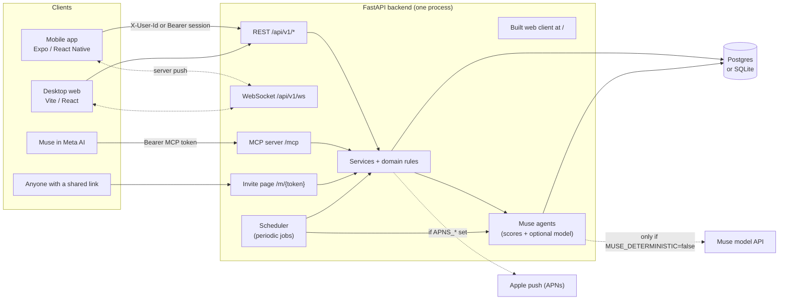

| Piece | Where | One line |
| --- | --- | --- |
| Mobile app | `frontend/mobile` | The main experience. Mock Facebook shell with a Moves tab (map), composer, Move detail, Memories. |
| Desktop web | `frontend/web` | Facebook desktop shell; Moves, Pull up, posting, Snapshots, Memories are live, the rest is demo content. |
| Backend | `backend/app` | FastAPI. Layered (`domain` / `services` / `api`), split into lanes wired at startup. |
| Muse | `backend/app/muse` | Every AI decision. Deterministic scores by default; the model is opt-in and always has a fallback. |
| Realtime | `backend/app/realtime/hub.py` | One WebSocket per client, server push only. Every notification is also stored. |
| Muse in Meta AI | `backend/app/mcp_server.py` | Remote MCP connector so Muse in Meta AI can draft, confirm and share Moves by voice. |

---

## 1. Product in one page

### 1.1 The prompt

"Build the AI-powered Facebook feature you wish existed for young adults." AI must be essential,
not decorative. **The Muse model API must power the core AI.** We mock the Facebook surface; we
never touch real Facebook code.

### 1.2 The idea

RSVPs are friction: "Am I free Wednesday? I don't know. But I know if I'm free *now*." People
already share what they are doing, so:

- A **Move** is a post of what you are doing or about to do ("getting matcha, who's down?").
  No event, no RSVP.
- Friends get poked and **Pull up** with one tap, or ignore it.
- A **Mark** is a place pin. The map shows *activities at places*, never people's live positions.
- **Muse** decides who hears about a Move, ranks Moves for you, proposes Flares for calendar
  gaps, learns taste from ratings and revives crews that are going quiet.

**Why young adults:** location sharing is now a normal way for friends to keep up. People like
sharing what they're doing, and they like knowing what their friends are doing. Location sharing
shows that but gives you no way to act on it. Moves keeps the awareness, shares a chosen place
instead of a live position, and adds the one-tap way to join.

Mobile is the primary experience; web is for when a laptop is already open.

### 1.3 Growth loop (the pitch)

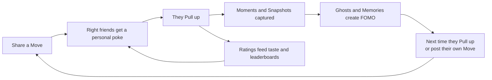

Reels watch time becomes real-world plans; Circles turn Groups into curated in-person time.

### 1.4 Vocabulary (use these exact words in code and UI)

| Term | Meaning |
| --- | --- |
| Move | A live, spontaneous activity at a place, posted by a user. |
| Mark | A place pin on the map. Its category sets its icon. |
| Saved Mark | A Mark a user saved (from the map or a Reel). |
| Pull up | Join a Move ("I'm going"). |
| Flare | A Move with a short fill window (5 to 10 min), usually proposed by Muse for a calendar gap. |
| Ghost | The gray avatar left at a Mark for 24 h after someone leaves a Move. |
| Moment | A photo captured during a Move. A **Snapshot** is an untagged Moment taken live. |
| Memory | Your private record of a Move you arrived at, with who else was there. |
| Circle | A user-defined audience ("Roommates"). Maps to a Facebook Group in the real product. |
| Pseudo-group | A crew Muse infers from history ("weekday coffee crew"). Never a real group; suggestions only. |
| Open Move | A Move marked open so nearby strangers could discover it over BLE. Off by default. |

### 1.5 Non-negotiable product rules

Every feature obeys these. They are enforced in code (section 12), not just copy.

1. **Location is always opt-in.** The app works with every permission denied (pick a Mark by search).
2. **Never show live location.** A Move shows a *place*; avatars sit at the Mark's coordinates.
   Raw GPS never leaves the device except as a coarse, unstored "near" query. No response schema
   carries user coordinates.
3. **Never fully public.** A Move goes to the Circles and people the poster picks. "Open" only
   widens discovery to physically nearby people over BLE, and only when the poster turns it on.
4. **It is always obvious who will see a post.** The composer shows the audience line before
   posting, and your own Move cards show it after.
5. **Proximity actions are a one-tap prompt.** Silent auto-join only for people on your auto-join list.
6. **Muse proposes, the user disposes.** Muse never posts a Move or sends a Flare without a tap.
7. **Moments need approval.** Anyone tagged approves a Moment before it is visible beyond the
   people who were in the Move.

Edge cases go to the privacy pass (12.5), not the critical path.

### 1.6 Decided against (do not build)

- Spin-wheel pickers, events, RSVPs days ahead, "choose from options" polls.
- Live location, fully public posting, building on real Facebook code.
- Dating positioning, a recording feature, agent-to-agent planning of future Moves.
- Marketplace pickup Moves and safety check-in (pitch line only, 11.3).
- Auto recap Reels; glasses "save this place" and POV Moments (pitch only).
- Crew and Movers leaderboards.

---

## 2. Scope and status

What exists today. "Partial" means the backend path works but something listed is missing.

| Feature | Status | Section |
| --- | --- | --- |
| Mock Facebook shell (mobile and web) | Built | 6 |
| Map of Marks, live Moves, Move sheet, Muse search box | Built | 7.1, 10.13 |
| Share a Move (two-step composer, audience line, poke step) | Built | 7.2 |
| Pull up, arrive, leave, end, auto-end | Built | 7.3 |
| Ghosts, Moments, Snapshots, Memories | Built | 7.4 |
| Realtime notifications, APNs push, share links | Built | 9 |
| Muse: notify picker, writer, ranker, flare, taste, revive, nobody-bit | Built (deterministic default) | 10 |
| Ratings (face + pairwise) and leaderboards | Built | 13 |
| Reels place chip, saved Reel Flare | Built | 11.1, 11.2 |
| Proximity: sim co-presence and real BLE on iOS dev builds | Built | 8 |
| Glasses: MCP connector and in-app voice screen | Built | 11.4 |
| Demo Control | Built | 15.2 |
| Route and ride suggestion | Built (agent + Demo Control trigger, no automatic trigger) | 10.10 |
| Open Moves discovered over BLE | Not built: join path exists, beacon discovery does not | 8.5 |

**Demo-safety rule:** anything that depends on hardware, timing or another person has a
Demo Control trigger (15.2) that fires the same code path.

---

## 3. System overview

The diagram in [At a glance](#at-a-glance) shows the runtime pieces. Inside the backend,
dependencies point inward and the lanes plug into shared slots:

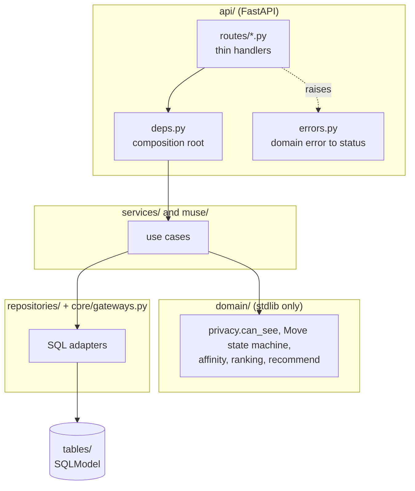

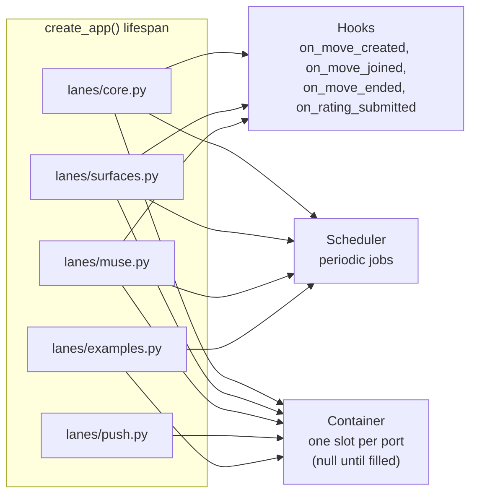

- **Ports** (`app/ports.py`) are the cross-lane contract: `Clock`, `EventPublisher`,
  `MoveGateway`, `MarkGateway`, `UserGateway`, `Notifier`, `MuseGateway`, `ProximityGateway`,
  `CalendarGateway`, `PushSender`, `TimeControl`. Each has a null version in `ports_null.py`,
  so the app boots with any lane missing (`create_app(lanes=())` is how contract tests run).
- **Hooks** (`app/hooks.py`) let one lane react to another without importing it. Handlers run
  in order; an exception is logged and swallowed so one lane never breaks another.
- **Scheduler** (`scheduler/loop.py`) runs these jobs:

| Job | Every | Lane | Notes |
| --- | --- | --- | --- |
| `end_stale_moves` | 60 s | core | Auto-end (7.3) |
| `proximity_purge` | 10 min | surfaces | Drops sightings older than 2 h |
| `example_moves` | 5 min | examples | Keeps seeded example Moves live |
| `muse_expire_suggestions` | 60 s | muse | |
| `muse_flare_scan` | 60 s | muse | Not in `DEMO_MODE` (Demo Control instead) |
| `muse_nobody_bit` | 60 s | muse | Not in `DEMO_MODE` |
| `muse_pseudo_groups` | 24 h | muse | Not in `DEMO_MODE` |

- **Middleware** (outermost first): `SessionAuthMiddleware` turns a session token into the
  `X-User-Id` routes read; `TimezoneMiddleware` records each phone's zone; CORS.

### 3.1 Key decisions

| Decision | Choice | Why |
| --- | --- | --- |
| Client | Expo SDK 57, React Native 0.86, TypeScript, expo-router, zustand | One codebase for demo phones; runs in Expo Go with BLE simulated, or a dev build for real BLE. |
| Map | `react-native-maps` on native, Leaflet on web | No API key on iOS. |
| Web | Vite + React (JavaScript), separate from Expo web | Desktop Facebook layout. |
| Backend | FastAPI, Python 3.12, uv, layered | Business rules testable without HTTP. |
| Storage | SQLModel. Postgres when `DATABASE_URL` is set, SQLite file otherwise; tests use in-memory SQLite | Same code in Docker and on a laptop. Foreign keys enforced. |
| Realtime | One WebSocket per client, server push only | More reliable than push on venue Wi-Fi. |
| Push | APNs (token `.p8` key) when `APNS_*` is set; otherwise in-app only | Lock-screen effect without breaking dev setups. |
| Auth | Username + password (`/auth/signup`, `/auth/login`, scrypt hashes). Login returns a session token; the app sends `Authorization: Bearer` (WebSocket `?token=`). The middleware turns it into `X-User-Id`, overriding any client value. `AUTH_REQUIRE_SESSION=true` also rejects a bare `X-User-Id`. Seeded people log in as first name + `moves` | Routes stay simple; the mock picker still works with the flag off. |
| AI | Muse behind `MuseClient`; deterministic by default (`MUSE_DETERMINISTIC=true`) | Muse is essential, but a failed call must never break the demo. |
| Local time | Phones send `X-Timezone` and `X-UTC-Offset`; `core/timezones.py` remembers it per user in memory | "Free til 2:50" matches the reader's clock. A zone is not a location. |
| Places | Seeded `marks` plus user-created Marks; city name from Nominatim (`GEOCODER_URL`) | No Places API dependency. |
| Hosting | One container serves web at `/` and the API at `/api/v1` (root `Dockerfile`, `docker-compose.yml` with Postgres). Every push to `main` redeploys the homelab (`.github/workflows/deploy-homelab.yml`, `deploy/homelab/`) | One origin, one port, no separate web host. |

### 3.2 Muse model configuration

- `MUSE_DETERMINISTIC=true` (default): no model calls at all. Scores and templates answer
  everything; `GET /muse/status` reports `live: false`.
- `MUSE_DETERMINISTIC=false` with `MUSE_API_KEY`: agents call the model.
  `MUSE_MODEL` (default `muse-spark-1.3`) for most agents, `MUSE_FAST_MODEL` (default
  `muse-ember-1.0`) for `move_writer`, `place_resolver` and crew labels.
  `MUSE_VISION_MODEL` only once image input is confirmed.
- No key, or `DEMO_MODE=offline`: `FakeMuseClient`.
- `MUSE_TOKEN_BUDGET` (default 400k) caps tokens per process; past it every agent falls back.
- Only `muse/client.py::HttpMuseClient.complete()` knows the wire format (Messages-compatible,
  `POST {MUSE_BASE_URL}/v1/messages`). Smoke test: `uv run python -m app.muse.smoke`.
- Environment values win over source defaults: change them on a deployment and restart.

---

## 4. Repository layout

```text
hackmeta-26/
├── ARCHITECTURE.md             this file
├── AGENTS.md                   contributor and agent rules (CLAUDE.md points here)
├── Dockerfile, docker-compose.yml   combined web + API image, with Postgres
├── deploy/homelab/             the server-side deploy script and its notes
├── docs/                       task plan, Muse search, audits (see section 17)
├── postman/                    smoke collections for the core API
├── backend/
│   ├── ARCHITECTURE.md         layering walkthrough and "Adding a feature"
│   ├── app/
│   │   ├── main.py             create_app(): middleware, routers, /mcp, web mount, lanes
│   │   ├── container.py        one slot per port, null until a lane fills it
│   │   ├── ports.py            cross-lane contract (ports, snapshots, vocabulary)
│   │   ├── ports_null.py       no-op implementation of every port
│   │   ├── hooks.py            lifecycle hooks between lanes
│   │   ├── lanes/              core, surfaces, muse, push, examples: each wires itself
│   │   ├── core/               config, db, clock, session auth, timezones, areas, SQL gateways
│   │   ├── domain/             pure rules: moves, privacy, affinity, ranking, recommend, ...
│   │   ├── services/           use cases: moves, notify, moments, proximity, ratings, reels, ...
│   │   ├── repositories/       SQL adapters and the unit of work
│   │   ├── tables/             SQLModel tables, one module per write-owner
│   │   ├── models/             request and response schemas
│   │   ├── muse/               client, runner, context, gateway, search, prompts/, agents/
│   │   ├── realtime/hub.py     ConnectionHub: user_id to sockets
│   │   ├── scheduler/loop.py   periodic jobs
│   │   ├── push/apns.py        APNs HTTP/2 client
│   │   ├── mcp_server.py       remote MCP server at /mcp (tools in services/mcp_tools.py)
│   │   ├── web.py              serves the built desktop web client at /
│   │   ├── api/                routes/, deps.py, errors.py, invite_page.py, read_cache.py
│   │   └── seed/               demo world: core, history, surfaces, muse steps; topup
│   └── tests/                  core, muse, surfaces, social, messages, push, demo, seed,
│                               contract, integration
└── frontend/
    ├── mobile/                 Expo app
    │   ├── app/                expo-router screens (route map in 16.1)
    │   ├── components/         fb/ (Facebook chrome), moves/, move/, composer/, muse/, ui/, ...
    │   ├── lib/                one zustand store per feature, endpoints.ts, types.ts,
    │   │                       realtime.ts, session.ts, ble.ts, mock/ (sample world)
    │   ├── modules/moves-ble/  local Expo module (Swift) for BLE advertise + scan
    │   ├── plugins/            config plugins (scene lifecycle, manual signing)
    │   └── scripts/            install-ios.sh, sync-meta-icons.mjs
    └── web/                    Vite + React desktop client (src/api.js talks to the backend)
```

---

## 5. Data model

SQLModel tables in `backend/app/tables/`, split by the lane that writes them. IDs are short
string UUIDs; timestamps are UTC. Postgres in deployment, SQLite locally.

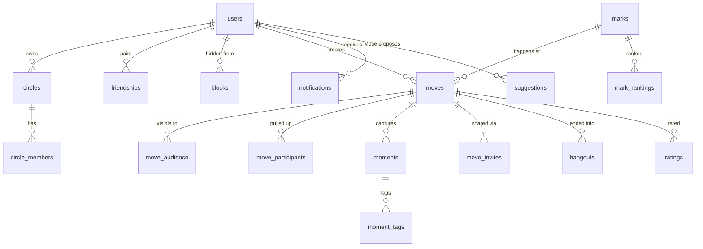

| File (owner) | Tables |
| --- | --- |
| `core.py` (core) | `users`, `friendships`, `circles`, `circle_members`, `blocks`, `user_settings`, `autojoin_prefs`, `marks`, `saved_marks`, `moves`, `move_audience`, `move_audience_circles`, `move_participants`, `moments`, `moment_tags` |
| `accounts.py`, `sessions.py`, `friends.py` | `credentials`, `auth_sessions`, `friend_requests` |
| `muse.py` (muse) | `muse_runs`, `taste_profiles`, `pseudo_groups`, `suggestions`, `notifications`, `muse_mutes` |
| `surfaces.py` (surfaces) | `proximity_tokens`, `proximity_sightings`, `copresence`, `hangouts`, `ratings`, `mark_rankings`, `calendar_events`, `reels`, `saved_reels` |
| `messages.py`, `mcp.py`, `push.py` | `move_invites`, `mcp_tokens`, `push_tokens` |

### 5.1 People and audiences

- `friendships` is undirected (one row, `user_a < user_b`). `friend_requests` holds pending adds.
- `circles` may carry `fb_group_name` for the Groups tie-in.
- `blocks(user_id, hidden_from_user_id)`: the first user's Moves never reach the second.
- `user_settings`: `location_opt_in`, `ble_opt_in`, `calendar_opt_in` (all default off),
  `muse_proactive` (on), `default_circle_ids`, `move_categories`, `quiet_hours`, `ghost_visible`.
- `autojoin_prefs(user_id, other_user_id)`: directional consent to silent auto-join.
- `credentials` (scrypt hashes) and `auth_sessions` (SHA-256 of session tokens) back real accounts.

### 5.2 Places

`marks`: name, category, lat/lng, address, photo, price, `vibe_tags`, `source` (seed, user, reel).
`saved_marks`: per user, with `source` (map, reel) and `flared_at` so Muse does not repeat itself.

Mark categories (closed list, each with an icon and color):
`food`, `coffee`, `study`, `fitness`, `nightlife`, `outdoors`, `games`, `shopping`, `errand`, `other`.
The Move writer may override a place's category ("study with me" at a café renders as `study`).

### 5.3 Moves

- `moves`: `creator_id`, `mark_id`, `text`, `category`, `status` (live, ended, cancelled),
  `kind` (move, flare), `open`, `starts_at`, `fill_deadline`, `ends_at`, `origin`
  (manual, map, reel, saved_flare, free_time, revive, glasses, nobody_bit), `origin_ref`.
- `move_audience(move_id, user_id, via)`: exactly who can see it, resolved at post time.
  `via` is `circle:<id>`, `direct` or `open_ble`. `move_audience_circles` keeps the label.
- `move_participants`: `status` (going, there, left), `joined_via`
  (creator, tap, ble_prompt, ble_auto, open_ble), `joined_at`, `arrived_at`, `left_at`.
- `moments` (+ `moment_tags` with per-tag `approved`): `status` pending or approved.

### 5.4 Signals and AI state

- `proximity_tokens` (rotating BLE tokens to user), `proximity_sightings` (raw, purged after 2 h),
  `copresence` (friend pairs together right now).
- `hangouts`: one row per pair per ended Move both arrived at. The history Muse learns from.
- `ratings`, `mark_rankings` (per-user ordered list with 0 to 10 scores).
- `taste_profiles`, `pseudo_groups`, `muse_mutes` (crews the owner muted, keyed by sorted members).
- `suggestions`: anything Muse proposes (flare, free_time, revive, route, reel_move, nobody_bit).
- `notifications`: every notification, also pushed over the socket.
- `muse_runs`: audit and cost log of every agent call.

### 5.5 Mocked Facebook surfaces

`calendar_events` (mock or title-less busy blocks from the phone), `reels`
(with `geotag_mark_id` and `resolved_mark_id`), `saved_reels`.

---

## 6. Mock Facebook shell

The app must read as "Facebook with a new tab".

- Bottom tabs in Facebook's order: **Home, Reels, Moves, Profile, Notifications, Menu**.
  Moves takes the Friends slot. Header: wordmark left; plus, search, Messenger right.
- Brand SVGs live in `frontend/mobile/components/fb/brand/`; generic icons from
  `lucide-react-native`; Facebook glyphs reuse the web's SVGs
  (`node scripts/sync-meta-icons.mjs` from `frontend/mobile`).
- Mock content uses the seeded cast and invented pages, never real brands.
- Home feed: static mock posts plus live **Move cards** and **Muse cards** (pending suggestions).
- A Circle with `fb_group_name` shows a "Group" tag; the composer says "Share to group: ...".
- **Sample world:** with `EXPO_PUBLIC_DEMO=1` or no network, screens may fall back to the
  bundled world in `lib/mock/` with a "Sample data" marker; nothing mutates in that mode.

---

## 7. Core loop

### 7.1 Map of Marks (`app/(tabs)/moves.tsx`)

- Full-screen map (native maps, Leaflet on web). Starts at the user's coarse location if opted
  in, else the seeded campus center.
- Data: `GET /moves/nearby` (visible live Moves, already ranked, 10.5) and `GET /marks/nearby`
  (Saved Marks and ghosts). Your own live Moves also come from `GET /moves/feed`.
- Pins: active Move shows the category with an avatar stack of people who are `there`
  (`going` is a count); ghosts are gray; Saved Marks are a bookmark.
- Tapping a pin opens the Move sheet: place, text, who's there and on the way, audience
  (to the creator), fill timer, **I'm going**, save, Moments.
- The bottom search pill is the **Muse search** prompt box (10.13).
- Refresh: realtime events plus a poll every 20 s while focused. Hot reads have a 5 s
  per-user server cache (`api/read_cache.py`).

### 7.2 Share a Move (`app/move/new.tsx`)

Two steps, so posting never waits on Muse.

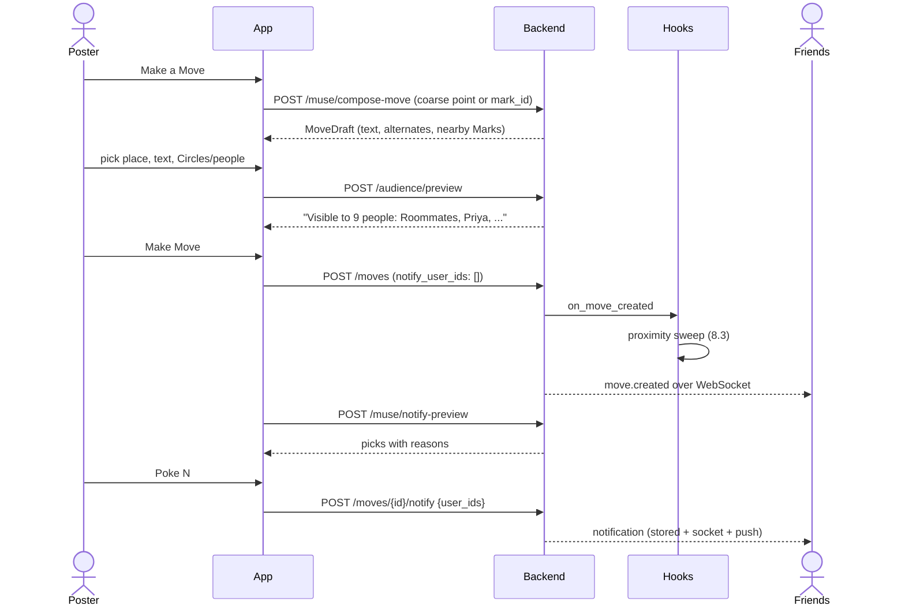

1. **Where, what, who.** Muse's draft text plus alternate chips, a place (nearest Marks if
   location is on, else search or drop a new Mark), and Circles plus friends. The
   **AudienceLine** shows exactly who can see it. Blocked users are excluded and never listed.
2. **Make Move** posts with `notify_user_ids: []`, so nobody is poked yet.
3. **"Your Move is live"**: Muse's picks from `/muse/notify-preview` (with reasons) plus anyone
   picked by hand, pre-checked. **Poke N** pokes only audience members not already poked.
   **Share link** sends a no-login page (9.4). **Done** opens the Move on the map.

Server on `POST /moves`: resolve the audience (Circles + direct picks, minus blocks and self)
with the same `resolve_audience` the preview uses; create the Move with the creator as
participant; fire `on_move_created` (proximity sweep, notify pipeline); publish `move.created`.

The composer form renders at once; lists load independently with a 12 s deadline and the Muse
draft with 25 s. Late replies never overwrite what the user typed.

### 7.3 Pull up, arrive, leave

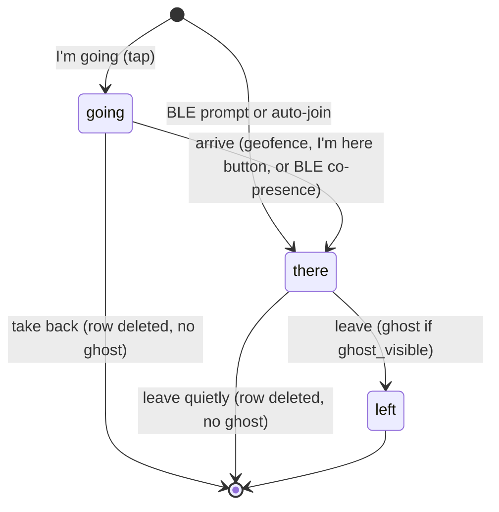

- **I'm going** (`POST /moves/{id}/join`): adds the participant, publishes
  `participant.changed`, tells the creator, then a **second-order poke** to the joiner's close
  friends who are already in the audience. It never widens the audience.
- **Arrive** (`POST /moves/{id}/arrive`): from the "I'm here" button, the on-device geofence
  (the server never gets the coordinates), or BLE co-presence with someone already `there`.
- **Leave** (`POST /moves/{id}/leave`, optional `{quiet}`): a `going` leave is a take-back
  (row deleted). Leaving while `there` sets `left` and leaves a ghost. Quiet leave deletes the
  row with no ghost, hooks or notification.
- **End**: the creator ends it, everyone leaves, or the scheduler ends it 3 h after
  `starts_at` with no activity. A Move that gets nobody triggers the nobody-bit path (10.9).
- **On end** (`on_move_ended`): `hangouts` rows for every pair that was `there`, a
  `rating.prompt` to each participant, and a crew refresh.

### 7.4 Ghosts, Moments, Snapshots, Memories

- While `there`: full-color avatar at the Mark (never GPS).
- **Ghost**: after leaving (or the Move ending while still `there`), a gray avatar at the Mark
  for 24 h, if `ghost_visible`. Requires `arrived_at`. Visible to the original audience only.
- **Moments**: any participant uploads a photo (`POST /moves/{id}/moments`, multipart) and tags
  people. Participants see it at once; the rest of the audience only after every tag approves.
- **Snapshots** (`app/move/[id]/snap.tsx`): a one-shutter camera; the photo is an untagged
  Moment, approved at once.
- **Memories** (`GET /me/memories`, Menu then Memories, and the web Memories page): your
  private archive of Moves you arrived at, from the moment you leave, listing who else arrived
  and showing its Moments live (`moment.added`). Quiet leaves and never-arrived Pull ups are
  excluded. Turning Ghosts off hides the map trace but keeps your Memories.
- Media is served by authenticated `/media/{filename}` with the same visibility checks as
  Moments. Seed Mark images use the public allowlisted `/media/seed/marks/{asset}` route.

---

## 8. Proximity (BLE)

### 8.1 What it is for

1. **Group auto-join**: friends physically together get a one-tap prompt (or silent join if on
   the auto-join list) when one of them posts a Move.
2. **FOMO targeting**: people already together are never poked.
3. **Auto-arrive**: a `going` participant near someone `there` becomes `there`.
4. **Open Moves** (not built, 8.5).

### 8.2 How it works on the phone

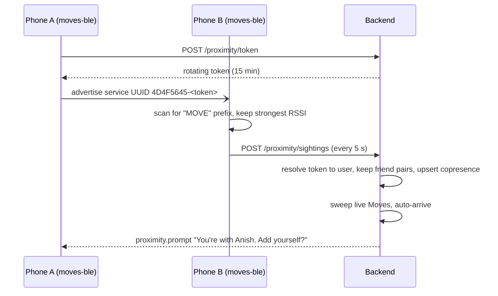

- Native module: `frontend/mobile/modules/moves-ble` (Swift, `CBPeripheralManager` +
  `CBCentralManager`), driven by `lib/ble.ts` (`useBleProximity`, mounted in the root layout).
- iOS cannot advertise service data, so the **token is the service UUID**: `4D4F5645-...`
  ("MOVE" + 12 random bytes). Devices never broadcast user IDs; only the server can resolve a token.
- Foreground only, and only with `ble_opt_in` on. Expo Go, web, or `EXPO_PUBLIC_PROXIMITY=sim`
  means no radio.
- **Sim path** (always available): Demo Control's `POST /demo/copresence` writes the same
  `copresence` rows and runs the same sweep.

### 8.3 Server logic

`services/proximity.py`, `services/proximity_sweep.py`, `repositories/proximity_ble.py`.

- **Ingest**: resolve tokens, keep RSSI at or above -75 dBm, upsert `copresence` for
  **friend** pairs only. A pair is co-present if seen within 60 s.
- **Sweep** (on Move creation and when co-presence changes): for each co-present audience
  member who is not a participant, auto-join as `there` (`ble_auto`) if they have an auto-join
  pref for someone there, else send a `proximity.prompt`. Accepting
  (`POST /proximity/prompt/{move_id}/accept`, optional `{always}`) joins as `there`.
- Everyone in the cluster joins the notify **exclusion set**, tap or not.

### 8.4 Privacy rules for proximity

- Off until `ble_opt_in`. Co-presence only between friends, never shown as a list, raw
  sightings purged after 2 h. A prompt only names people already in the Move.

### 8.5 Open Moves (not built)

Design: only for `open: true` Moves; a nearby, opted-in, **verified** user whose categories
match sees first names and badges and can join (`via: open_ble`). Today the join path and
`open` flag exist, but nothing advertises or discovers open-Move beacons.

---

## 9. Notifications

### 9.1 Transport

- **WebSocket** `GET /api/v1/ws?token=...` (or `?user_id=` with session auth off). Events are
  `{type, data, ts}`.
- Event types: `notification`, `move.created`, `move.updated`, `move.ended`,
  `participant.changed` (may carry `status: null`), `proximity.prompt`, `suggestion.created`,
  `moment.added`, `moment.approval_needed`, `rating.prompt`.
- Client: `lib/realtime.ts` reconnects with backoff and re-emits every envelope on
  `appEvents`; feature stores subscribe themselves. `ts` feeds `serverNow()` so countdowns
  follow the demo clock.
- Every notification is stored (`notifications`) and listed in the Notifications tab, and is
  pushed through APNs when configured (`aps.badge` is the unread count).

### 9.2 Notify pipeline (`services/notify.py`)

```text
candidates = move_audience
           - participants
           - co-present cluster          (FOMO rule, 8.3)
           - users in quiet hours
           - users already poked for this Move
           - users whose move_categories exclude this one (unless force-picked)
picked     = notify picker (10.3); creator's confirmed list forces in/out
send       = store notification, publish over WebSocket, push
```

Cap: at most `min(8, ceil(audience / 2))`. Fewer and better. The notification deep-links to
the Move with **I'm going** one tap away.

### 9.3 Notification types

| type | example |
| --- | --- |
| `move_nudge` | `Tony posted "matcha, who's down?" at Kumo Matcha.` |
| `friend_pulling_up` | "Priya's pulling up to Tony's Move." |
| `joined_your_move` | "Maya is on the way." (also guests from a shared link) |
| `proximity_added` | "Added you to Anish's Move. Undo" |
| `muse_flare`, `muse_free_time`, `muse_revive`, `muse_nobody_bit`, `muse_route` | Muse suggestions (10.6 to 10.10) |
| `rate_move` | "How was Kumo with Tony and Maya?" |
| `moment_approval` | "Maya tagged you in a moment. OK to share?" |
| `friend_request`, `friend_accepted` | Friend graph changes |

`data.route` values: `/move/{id}`, `/move/{id}/rate`, `/move/{id}/moments`,
`/suggestion/{id}`, `/friends`, `/user/{id}`.

### 9.4 Share a Move with people outside the app

- No SMS service. The app asks for a link and opens the phone's share sheet, so the text goes
  from the user's own number.
- Anyone who can see a live Move can share it. Each share is a `move_invites` row with its own
  token so the sharer sees opens and guest names. No phone numbers are stored.
- The page (`api/invite_page.py`, `/m/{token}` at the site root): no login, place, what's
  happening, first names, map links, and an "I'm pulling up" form that takes only a first name.
  Open Graph preview; `noindex`; details hidden once the Move ends.
- A guest going sends `joined_your_move` to the sharer and creator. Guests are not users.
- Set `PUBLIC_BASE_URL` so links work off the local network.

| Method | Path | Purpose |
| --- | --- | --- |
| POST | `/api/v1/moves/{id}/invites` | `{message?}` to `{url, text, body}` |
| GET | `/api/v1/moves/{id}/invites` | opens and guest names |
| GET | `/m/{token}` | public page |
| POST | `/m/{token}/going` | form post `name`, 303 back |

---

## 10. Muse

**Python computes facts; Muse makes judgments and writes words.** We never ask the model for
arithmetic over raw history, and never hardcode who gets notified.

**Deterministic by default.** With `MUSE_DETERMINISTIC=true` every agent answers instantly from
scores in `domain/` and templated copy, labelled `source: heuristic`. With it off, agents ask
the model and the same scores are the fallback. Every agent works with the model down.

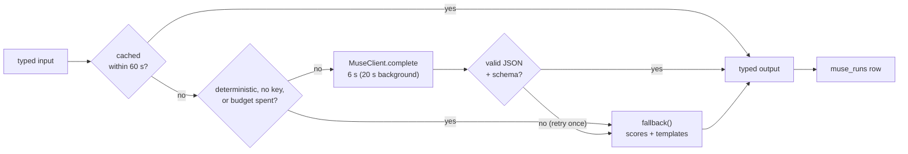

| Agent (`muse/agents/`) | When | Decides |
| --- | --- | --- |
| `notify_picker` | Poke step, create, second-order joins | Who to poke, with a reason |
| `move_writer` | Composer, glasses | Move text + 3 alternates + category |
| `place_resolver` | Reels, saved Reels | Which Mark a piece of content is about |
| `move_ranker` | `/moves/nearby`, `/moves/feed` | Order of visible Moves + reason line |
| `flare` | Scheduler, Demo Control | Flare or free-time suggestion for a calendar gap |
| `taste` | After a rating | Taste profile; spot suggestions |
| `revive` | Scheduler, Demo Control | Bring a fading crew back |
| `nobody_bit` | Empty Move or Flare | A live Move you can join instead |
| `route` | Two people heading to the same Move | "Go together?" |
| `intent` | Glasses, voice | Spoken command to a structured intent |
| `search_planner` | Map search box | Prompt to a `SearchPlan` (10.13) |

Every agent returns **reasoning chips** (1 to 3 short facts) shown in the UI.

### 10.1 Signals computed in Python (`domain/affinity.py`, `muse/context.py`)

For user U and candidate C: `hangouts_30d`, `hangouts_90d`, `last_hangout_days`,
`same_category_hangouts`, `same_slot_hangouts` (weekday type and hour bucket),
`same_mark_visits`, `pull_up_rate`, `shared_circles`, `is_close_friend`, and free/busy when C
opted into the calendar.

`affinity = 3·log(1+h30) + 1.5·log(1+h90) + 2·same_category + 1.5·same_slot + 4·pull_up_rate - 0.05·last_hangout_days`

Prompts use short aliases (`u1`, `u2`), first names and at most 25 candidates. No coordinates,
addresses or calendar titles.

### 10.2 Agent runner (`muse/runner.py`)

The one door every agent goes through (diagram above). Timeouts: 6 s user-facing, 20 s for
background agents. `FakeMuseClient` serves tests and `DEMO_MODE=offline`.
`GET /muse/status` and `GET /demo/muse-stats` report calls, tokens, budget and fallback rate.

### 10.3 Notify picker (`agents/notify_picker.py`)

Deterministic by default: top of the affinity ranking under hard rules (cap, never busy, at
most one verified "stretch" pick from a wider Circle). Every nudge reads one fixed line:
`{creator} posted "{text}" at {Mark}.` plus minutes left and who is there. Muse can make the
pick when a request sets `use_muse`; it never writes the line.

### 10.4 Move writer and place resolver

- **Writer**: Mark, time of day, taste, optional seed text, to
  `{text, category, alternates[3]}`. Lowercase, casual, under 60 characters.
- **Resolver**: geotag, caption or frame plus the 10 nearest Marks, to
  `{mark_id | new_mark, confidence}`. Below 0.6 the UI asks "Is this Kumo Matcha?".

### 10.5 Move ranker (`agents/move_ranker.py`, `domain/move_ranking.py`)

Computed on each request, no model call. `prefer(a, b)` compares weighted factors (people 4,
place 2, crowd 1.5, taste 1.5, urgency 1, momentum 1, freshness 0.5), then newest, then id, so
it is a strict total order. Binary insertion in id order makes the result independent of input
order. The reason line is the biggest factor ("Tony + Priya", "you loved Kumo", "3 min to join").

### 10.6 Calendar Flare and free time (`agents/flare.py`, `domain/recommend.py`)

The autonomous-agent story. Every 60 s (or from Demo Control) for users with `muse_proactive`:

1. Find a free window of at least 20 min from `calendar_events` (phone sends busy blocks only).
2. Score Saved Marks (own rating 2, taste fit 1.5, hangouts there with free friends 1.5,
   recency of save 1); flare when the best reaches 1.5. Invite up to 3 free friends by
   affinity (+2 for crew members). Otherwise a free-time nudge for a friend scoring at least 1.
3. Store a `suggestions` row and send `muse_flare` / `muse_free_time`. Accepting
   (`POST /suggestions/{id}/accept`) creates the Move (`kind: flare`, 5 to 10 min fill window).

Limits: 2 proactive suggestions per user per day, none in quiet hours, a dismissed Mark is
quiet for a week. Travel time is a straight-line estimate.

### 10.7 Taste learning (`agents/taste.py`)

After ratings, update `taste_profiles` (`{summary, likes, dislikes}`) per rater. Profiles feed
the writer, ranker, Flare and `POST /muse/suggest-spots` (3 Marks for a group, with reasons).

### 10.8 Pseudo-groups and revive (`domain/pseudo_groups.py`, `agents/revive.py`)

Cluster `hangouts` into recurring sets of 2 to 6 people with a shared pattern; Muse names them.
A crew is **fading** when its last hangout is older than 2.5x its usual gap (min 14 days).
Revive suggests getting the most valuable fading crew back together, at most weekly. The Crews
screen (`app/groups.tsx`) lists them with a sparkline, Revive and Mute.

### 10.9 Nobody bit (`agents/nobody_bit.py`)

When a Flare hits its deadline with no joiners, or a Move has none after 15 min: suggest the
best live Move the user is allowed to join (people, then taste, then distance). Accepting joins
it and ends the empty one. No candidates means no message. Never "nobody came".

### 10.10 Route and ride suggestions (`agents/route.py`)

Two audience members `going` to the same Move from the same coarse area, not walkable: "You
and Dev are both heading to Kumo from campus. Go together?" No booking. No Demo Control trigger.

### 10.11 Intent parser (`agents/intent.py`)

Spoken command to `{intent: start_move | none, text, audience_hint}`. Used by glasses.

### 10.12 Cost and latency guardrails

Per-agent `max_tokens`; candidate lists truncated (25 people, 15 Moves, 10 Marks); 60 s prompt
cache; process-wide token budget; user-facing calls show the heuristic result first.

### 10.13 Muse search (`muse/search.py`, `agents/search_planner.py`)

The map's search pill is a Muse prompt box. One model call plans the request, then the server
acts deterministically with the same code as the MCP tools. Results are a **draft** ("tell Divy
I want to go on a run"), **people**, **places** or a **clarify** question. Nothing posts without
a tap. Endpoints: `POST /muse/search`, `/muse/search/draft`, `/muse/search/confirm`.
Details in [docs/MUSE_SEARCH.md](docs/MUSE_SEARCH.md).

### 10.14 Tendency tab — `agents/move_tendency.py`, `domain/move_tendency.py`

People skip a Move that started 40 minutes ago because it looks over. Every live
Move gets a small tab: **"Started 7:00, Tony's Kumo Moves usually last ~2h"**. The
viewer works out that there is still time.

- **Facts (Python)**: the median length of the creator's last 30 ended Moves at the
  same Mark; else in the same category; else all of them. A level needs at least 2
  Moves. Moves under 10 min or at least `STALE_AFTER` (3 h, auto-ended) do not count.
  No level qualifies: no tab, never a guess.
- **Words (Muse)**: the template "{Name}'s {Mark|category|} Moves usually last ~2h"
  is returned at once (`source: heuristic`). With the model on, one batched call in
  the background rewrites the lines; the check rejects a line that changes the
  length, is over 70 characters or has "!". The next read shows Muse's line.
- **Wire**: `MoveRead.tendency` on every Move route, live Moves only. The route
  waits at most 1 s for `MuseGateway.move_tendencies` (a gateway extra), else null.
  The client adds "Started 7:00, " from `starts_at` in the viewer's time zone.
- **Privacy**: reads only Move times, Mark ids and categories of the creator's own
  past Moves. No coordinates, no other people.
- **Demo**: Tony posts the seeded Kumo Matcha runs in the history (15.1), so his
  live Kumo Move shows "Started {time}, Tony's Kumo Matcha Moves usually last ~1.5h".
  Shift the clock (`/demo/time`) to show that it still holds 40 minutes in.

---

## 11. Mocked Facebook surfaces

### 11.1 Reel to "Start a Move here"

Vertical Reels pager. A Reel with a resolved place shows a chip ("Kumo Matcha, 1.2 mi").
`GET /reels/{id}/place` returns the Mark, distance, any active Move with friends there, and a
draft. The sheet offers **I'm going** (friends there) or **Start a Move here**. Saving a Reel
(`POST /reels/{id}/save`) creates a Saved Mark with `source: reel`.

### 11.2 Saved Reel to Muse calendar Flare

Saved Reels appear in Saved and as map bookmarks. The Flare agent (10.6) joins saved place +
calendar gap + distance + crew. Demo: "Fire flare scan" inserts a lecture block, the
suggestion arrives with its reasoning card, tap yes, the Move goes out with a 10 min fill timer.

### 11.3 Marketplace (pitch line only)

"The same Move card works for a Marketplace pickup." One sentence in the demo close. Nothing built.

### 11.4 Meta glasses: "Hey Meta" through a Meta AI connector

The backend is a **remote MCP server** at `/mcp` (`app/mcp_server.py`, FastMCP, Streamable HTTP,
stateless, JSON responses). Meta AI owns the wake word and speech; it calls our tools.

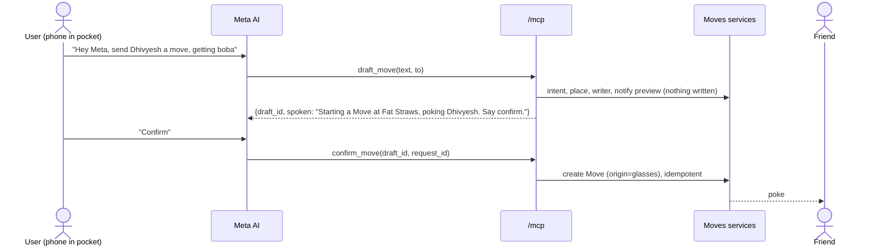

- **Auth**: per-user bearer token (`Authorization: Bearer` or `X-API-Key`), minted with
  username + password at `POST /api/v1/mcp/tokens`, shown once, SHA-256 stored, one per user.
  `/mcp` never reads `X-User-Id`. Anything else is 401.
- **Tools**: `draft_move` (writes nothing), `confirm_move` (only after the user says yes),
  `share_move`, `pull_up`, `friends_nearby` (places and activities, never positions),
  `get_my_active_move` (safe retry after a timeout). Writes are idempotent on `request_id`;
  every tool is bounded to 8 s.
- **Place**, in order: a venue the user named (fuzzy-matched), the Mark nearest the phone's last
  fresh point (within 2 km), the user's most-visited Mark, the demo Mark in `DEMO_MODE`; else the
  draft asks "Where at?". The phone's point comes from the open app (`POST /glasses/location`,
  rounded to ~100 m, kept in memory 30 min, only while location sharing is on, never stored).
  Coordinates sent by Meta AI are ignored.
- `to` resolves to friends only; an ambiguous name returns candidates.
- Drafts live 5 min in memory, shared with the fallback voice screen (`app/glasses.tsx`,
  `POST /glasses/command` and `/glasses/confirm`).
- In-app: Settings, then Connect Muse (`lib/museConnect.ts`) hands Meta AI the URL and token.

---

## 12. Privacy and trust

### 12.1 Enforcement points

- **`domain/privacy.py::can_see(viewer, move)`** is the only visibility check: creator, or a
  participant or audience member not blocked by the creator. `resolve_audience` is the only
  place an audience is computed, used by both the preview and `POST /moves`.
- **No user coordinates in any response schema.** Moves carry the Mark's coordinates only.
- **Coarse location**: clients round to 3 decimals for `/moves/nearby`, `/marks/nearby` and
  compose. The server stores only a coarse `last_area` label for opted-in users and clears it
  on opt-out. Access logs redact those query strings (`core/logging.py`).
- **Calendar**: only title-less busy blocks reach the server. The phone reads its own
  calendar with `expo-calendar` (`lib/calendar.ts`; on iOS that includes Google, Outlook and
  iCloud accounts added to the Calendar app, so no Google OAuth) and sends merged start/end
  blocks to `PUT /calendar/busy` on connect, foreground and every 10 min; titles stay on the
  phone. Blocks are stored only with `calendar_opt_in`, opting out deletes them, and Demo
  Control's flare and free-time scans clear them inside the staged window.
- **Muse prompts**: aliases and first names, only the fields in 10.1.
- **Media**: private uploads only through authenticated `/media` handlers with Moment checks.

### 12.2 Screens

Onboarding (what a Move shows, Circles, separate opt-ins with a working "Not now"); Settings,
then Privacy (toggles, Hidden from, auto-join, ghosts, categories, quiet hours); AudienceLine on
the composer and own Move cards; Circles management.

### 12.3 Verification

`fb_verified` is a seeded flag shown as a blue check (`POST /me/verify` mocks it). Unverified
users cannot post or discover open Moves and are never Muse "stretch" picks.

### 12.4 Positioning

Not dating. Copy is about doing things; no relationship fields; open Moves show groups and
activities, not people to browse.

### 12.5 End-of-build privacy pass

Re-check every rule in 1.5 against the running app and settle: who sees `there` avatars at a
venue (audience today vs. only people at the venue); exactly what an open-Move stranger sees;
ghost lifetime; and that the 17.3 privacy tests pass.

---

## 13. Ratings and leaderboards

Beli-style: you rank by comparison and the app derives a 0 to 10 score.

### 13.1 Rating flow (`app/move/[id]/rate.tsx`)

From `rating.prompt` when a Move ends: a face (**Loved it / Fine / Not for us**), one or two
pairwise questions against your ranked list for that category ("Kumo Matcha or Fat Straws?"),
then vibe tags and a note. `POST /moves/{id}/rating` updates `mark_rankings` and fires
`on_rating_submitted` (taste, 10.7).

`domain/ranking.py`: binary insertion; score bands Loved 7.0 to 10.0, Fine 4.0 to 6.9,
Not for us 0.0 to 3.9; faces stay grouped; `same` is a tie.

### 13.2 Leaderboards (`app/leaderboards.tsx`)

**Top spots** (you and your friends, by category, your score vs. friends') and **Your list**.
Both computed on read from `mark_rankings`; friends only, so nothing leaks beyond audiences.

---

## 14. API contract

Base path `/api/v1`. Every request carries `X-User-Id` or a session token. Errors are
`{"detail": "..."}`; domain errors map to status codes in `api/errors.py`. Timestamps are UTC ISO.
Live docs: `http://localhost:8000/docs`.

### 14.1 Schemas

The wire types live in `frontend/mobile/lib/types.ts` and mirror the backend's `models/` and
`muse/schemas.py`. The exact shapes are pinned by
`backend/tests/contract/fixtures/core-openapi.json` and `tests/contract/test_plan_endpoints.py`;
change them together. Rules that hold for every schema:

- `source: 'muse' | 'heuristic'` is honest: `muse` only when the agent answered without falling back.
- `audience` on a Move is present for the creator only.
- No user `lat`/`lng` anywhere.
- `MoveRead.tendency` (`{line, typical_minutes, basis, sample_size, source}`) is set on live
  Moves with enough history only, else null (10.14).

### 14.2 Endpoints

| Area | Endpoints |
| --- | --- |
| Health, auth | `GET /health`; `GET /auth/users`; `POST /auth/signup`, `/auth/login` |
| Me | `GET/PATCH /me`; `POST /me/verify`; `PATCH /me/settings`; `GET /me/taste`; `GET /me/saved`; `GET /me/memories?limit&offset`; `GET/POST/DELETE /me/blocks`; `GET/PUT /me/autojoin`; `POST/DELETE /me/push-tokens` |
| People | `GET /users/search?q`; `GET /users/{id}`; `GET /friends`; `GET /friends/suggestions`; `GET/POST /friends/requests`; `POST /friends/requests/{id}/accept`; `DELETE /friends/requests/{id}`; `DELETE /friends/{id}` |
| Circles, audience | `GET/POST /circles`; `PATCH/DELETE /circles/{id}`; `POST /audience/preview` |
| Places | `GET /marks/nearby`, `/marks/search`, `/marks/{id}`; `POST /marks`; `POST/DELETE /marks/{id}/save`; `GET /areas/city` |
| Moves | `POST /moves`; `GET /moves/nearby`, `/moves/feed`, `/moves/{id}`; `POST /moves/{id}/join`, `/arrive`, `/leave`, `/end`, `/notify`; `GET/POST /moves/{id}/invites` |
| Moments | `GET/POST /moves/{id}/moments`; `POST /moments/{id}/approve`; `GET /media/{file}` (also at site root) |
| Muse | `GET /muse/status`; `POST /muse/compose-move`, `/muse/notify-preview`, `/muse/suggest-spots`, `/muse/search`, `/muse/search/draft`, `/muse/search/confirm` |
| Suggestions, crews | `GET /suggestions`; `POST /suggestions/{id}/accept`, `/dismiss`; `GET /pseudo-groups`; `POST /pseudo-groups/{id}/revive`; `POST/DELETE /pseudo-groups/{id}/mute` |
| Notifications | `GET /notifications`; `POST /notifications/read` |
| Proximity | `POST /proximity/token`, `/proximity/sightings`, `/proximity/prompt/{move_id}/accept` |
| Ratings, boards | `GET /moves/{id}/rating/questions`; `POST /moves/{id}/rating/next`, `/moves/{id}/rating`; `GET /leaderboards/spots`, `/leaderboards/my-list` |
| Calendar, Reels | `GET /calendar`; `PUT /calendar/busy`; `GET /reels`, `/reels/{id}/place`; `POST/DELETE /reels/{id}/save` |
| Glasses, MCP | `POST /glasses/command`, `/glasses/confirm`, `/glasses/location`; `GET/POST /mcp/tokens`; `DELETE /mcp/tokens/{id}`; `POST /mcp` (site root, bearer token) |
| Realtime | `WS /ws` (9.1) |
| Demo | `/demo/*` (15.2), 404 unless `DEMO_MODE` |
| Template example | `/notes` (kept to illustrate the layering) |

---

## 15. Seed data and demo control

### 15.1 Seed world (`backend/app/seed/`)

- `uv run python -m app.seed.seed` **drops and rebuilds** the configured database, including
  real accounts. Use only on data you mean to reset.
- `uv run python -m app.seed.topup` inserts only missing seed rows and never drops anything.
  Prefer it on a shared database.

The world gives every Muse feature real signal: one campus area (UT Dallas, Richardson to Plano)
with 30 to 40 Marks including Kumo Matcha; 12 to 15 people (**Anish** is the main demo phone;
Tony, Maya, Priya, Dev, Dhivyesh; Jordan hosts the open pickleball Move; "Mom" is on Anish's
hidden-from list); Anish's Circles (Roommates, Climbing as a Facebook Group, HS friends, Study
group); 8 weeks of history with deliberate patterns (a matcha crew, a lunch crew, a climbing crew
that stopped 4 weeks ago, one HS hangout); ratings; live Moves; ghosts with Moments; 4 Reels; and
a calendar with a 2:10 to 3:00 gap. Seed steps are split by lane (`core.py`, `history.py`,
`surfaces.py`, `muse.py`).

### 15.2 Demo Control (`app/demo.tsx`, `/demo/*`, only when `DEMO_MODE` is set)

`DEMO_MODE=on` gives a shiftable clock and these routes; `offline` also swaps in the fake Muse
client. The panel is hidden in every build: in Settings, tap the version line ("Moves 1.0.0")
five times quickly, or long-press it. Nothing else links to it. Without `DEMO_MODE` on the server
the panel says demo mode is off. The panel's sections are Scenes (whole demo beats in one tap,
chained client-side from the triggers below, a couple of seconds apart), Time, Muse, People,
Moves and System.

| Control | Endpoint | Effect |
| --- | --- | --- |
| State | `GET /demo/state` | mode, now, offset, Muse client |
| Reset | `POST /demo/reset` | soft: clock offset 0, example Moves revived, pending suggestions expired, demo calendar and co-presence removed. Never drops data |
| Time | `POST /demo/time` `{iso}` or `{offset_minutes}` | shifts `core/clock.py` |
| Flare scan | `POST /demo/flare-scan` | inserts a lecture block, ensures a Saved Mark, runs 10.6 forced |
| Free time | `POST /demo/free-time` | "Want to start a Move?" |
| Revive scan | `POST /demo/revive-scan` | runs 10.8 |
| Co-presence | `POST /demo/copresence` `{user_ids, on}` | writes or clears friend co-presence and sweeps (8.3) |
| Friend posts / pulls up / leaves / accepts | `POST /demo/friend-move`, `/friend-join`, `/friend-leave`, `/friend-accept` | another person acts |
| End Move | `POST /demo/end-move` | ghosts, hangouts, rating prompt; holds example Moves ended |
| Nobody bit | `POST /demo/nobody-bit` | expires a fill window with no joiners (10.9) |
| Muse stats | `GET /demo/muse-stats` | calls, tokens, budget, fallback rate |
| Friend request | `POST /demo/friend-request` `{user_id?}` | someone (default: first non-friend, Jordan in the seed) sends you a request |
| Moment | `POST /demo/moment` `{user_id, move_id?}` | that friend arrives at your newest live Move and posts a photo Moment tagging you (approval request) |
| Route | `POST /demo/route` `{user_id, mark_id?, companion_id?}` | they post a Move at a far Mark (default Kumo); you and a shared friend pull up from the same coarse area; runs 10.10 |
| Muse mode | `POST /demo/muse-mode` `{live}` | live model vs heuristics at runtime (shows the fallback story); reset restores `MUSE_DETERMINISTIC` |
| Test notification | `POST /demo/notify-test` | a notification (and push) to you, to check the phone before going on |
| Jobs | `GET /demo/jobs`, `POST /demo/jobs/{name}` | run a registered scheduler job now (auto-end, expiry, example Moves, purge) |

In `DEMO_MODE` the autonomous Muse jobs are not scheduled; Demo Control is the deterministic
path. **All backend time reads go through `core/clock.py`**; never `datetime.now()` in services.

### 15.3 Demo script (target 4 minutes)

1. **Hook** (20 s). Open the app as Anish. "I don't know if I'm free Wednesday. I know I'm free now."
2. **Reel to Move** (40 s). Tap the Kumo chip, "Tony + 2 friends are here rn", I'm going. Priya's phone gets the poke.
3. **Map and ghosts** (30 s). Marks, avatar stacks, "For you" reasons, a ghost from last night with Moments.
4. **Share a Move + proximity** (45 s). Audience line, Muse's poke list with reasons; the phone nearby gets "You're with Anish. Add yourself?", the far one gets the poke.
5. **Muse acts on its own** (45 s). Flare scan, reasoning card, tap yes, 10 min fill timer.
6. **After the Move** (30 s). End, rate with one pairwise question, leaderboard, taste line, revive card.
7. **Nobody bit** (20 s). An empty Flare; Muse offers Jordan's open pickleball Move.
8. **Trust** (20 s). Privacy screen: place not person, opt-ins, audience line, hidden-from Mom.
9. **Glasses** (30 s). "Hey Meta, send Dhivyesh a move, getting boba." Backup: in-app voice screen or a laptop MCP client.
10. **Close** (20 s). The Marketplace line, then the growth loop.

---

## 16. Frontend architecture notes

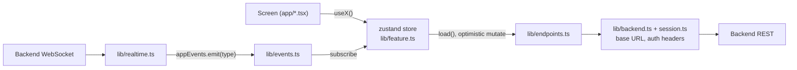

- **State**: one zustand store per feature in `lib/<feature>.ts` with `status`/`error`,
  `load()`, optimistic mutations that roll back with `toast(errorMessage(e))`, and an
  `onLogout` reset. No TanStack Query. After a Move mutation, emit `moves.changed`.
- **Backend URL**: `EXPO_PUBLIC_BACKEND_URL`, else port 8000 on the Expo host (LAN discovery).
  The backend must listen on `0.0.0.0`.
- **Screens**: `LoadingState`, `ErrorState` with Retry, `EmptyState`; `StackScreen` for new
  screens; `useOpenTarget()` and `routeFor()` (`lib/nav.ts`) for anything notification-like;
  `composerHref(...)` into the composer.
- **Root layout** (`app/_layout.tsx`) mounts `useRealtime`, `usePush`, `useLocationPing`,
  `useBleProximity`, and the overlays `OfflineBar`, `InAppBanner`, `ProximityPrompt`, `Toast`.
- **Permissions**: asked in context (location on first map open, BLE and calendar from
  onboarding or privacy, push after the first meaningful action); every feature has a
  no-permission path.
- **Flags**: `EXPO_PUBLIC_BACKEND_URL`, `EXPO_PUBLIC_PROXIMITY=ble|sim`, `EXPO_PUBLIC_DEMO=1`,
  `EXPO_PUBLIC_MCP_URL`, `EXPO_PUBLIC_MUSE_URL`.
- **Deep links**: scheme `hackmeta26://`; notifications carry `data.route`.
- **Web client** (`frontend/web`): plain React; `src/api.js` sends the session token on API
  calls, media and the socket. It never reads the viewer's location ("near" uses a fixed campus point).

### 16.1 Route map (`frontend/mobile/app`)

All routes sit under the signed-in guard in `app/_layout.tsx`.

| Path | File | Reached from |
| --- | --- | --- |
| `/login` | `login.tsx` | signed out |
| `/onboarding` | `onboarding.tsx` | after signup |
| `/`, `/reels`, `/moves`, `/notifications`, `/profile` | `(tabs)/*.tsx` | tab bar |
| `/search` | `(tabs)/search.tsx` (hidden tab) | header search |
| `/menu` | `menu.tsx` | hamburger |
| `/post/new`, `/post/share` | `post/*.tsx` | Home composer (mock posts) |
| `/move/new` | `move/new.tsx` | Make a Move, suggestion accept, Reel, crew, Mark |
| `/move/[id]` | `move/[id]/index.tsx` | Move cards, notifications, feed, profile |
| `/move/[id]/moments`, `/rate`, `/snap` | `move/[id]/*.tsx` | Move detail, ghost card, `rate_move`, `moment_approval` |
| `/suggestion/[id]` | `suggestion/[id].tsx` | `muse_*` notifications, Muse cards |
| `/memories` | `memories.tsx` | Menu, Memories |
| `/calendar`, `/leaderboards`, `/saved`, `/groups` | `*.tsx` | Menu tiles |
| `/mark/[id]` | `mark/[id].tsx` | Move place row, leaderboards, Saved, Reels |
| `/friends`, `/user/[id]`, `/profile/edit` | | Menu, people rows, Profile |
| `/circles`, `/circles/[id]` | `circles/*.tsx` | Menu Groups, Privacy, composer |
| `/settings/*` | `settings/{index,privacy,hidden,autojoin,notifications,muse}.tsx` | Menu gear |
| `/glasses` | `glasses.tsx` | fallback voice screen |
| `/demo` | `demo.tsx` | Hidden: tap the Settings version line 5 times (or long-press it) |

Menu tiles with no feature (Marketplace, Feeds, Pages, Gaming, ...) open a "Coming soon" sheet.

---

## 17. Workstreams

### 17.0 Backend lanes

| Lane | Owns (writes) | Wires itself in |
| --- | --- | --- |
| Core | Move lifecycle, privacy, Marks, Circles, users, Moments, WebSocket hub, core seed | `lanes/core.py` |
| Muse | `muse/**`, notify pipeline, notifications, suggestions, taste, pseudo-groups, Muse jobs | `lanes/muse.py` |
| Surfaces | Proximity, Reels, calendar, ratings, leaderboards, hangouts, glasses, Demo Control, history seed | `lanes/surfaces.py` |

A lane writes only its own tables; cross-lane behaviour goes through ports and hooks (section 3).
`ports.py`, `hooks.py`, `tables/`, `api/main.py` and `api/deps.py` are shared and frozen.
Full plan with issue IDs: [docs/BACKEND_TASKS.md](docs/BACKEND_TASKS.md). On
`mobile/facebook-shell` the ownership rules are waived (see AGENTS.md); layering, domain errors
and the Clock rule still hold.

### 17.1 History

The build ran P0 (core loop) then P1 (FOMO, retention, surfaces) then P2 (glasses, BLE).
[docs/FEATURE_AUDIT.md](docs/FEATURE_AUDIT.md), `CORE_BRANCH_REVIEW.md`,
`CORE_RUNTIME_VERIFICATION.md` and `PERF_AUDIT.md` are point-in-time snapshots, not current status;
section 2 is current.

### 17.2 Definition of done for any feature

- Follows 1.5; `can_see` is the only visibility path.
- Has a Demo Control trigger if it depends on time, hardware or another person.
- Works with Muse down and every permission denied.
- Backend: a service-level test; `uv run pytest && uv run ruff check .` pass.
- Frontend: loading, empty and error states; no red screen on a dropped socket.

### 17.3 Tests that must exist

- Privacy: a blocked user and a non-audience friend cannot fetch a Move by id, nearby, feed,
  ghost or Moments.
- No user coordinates in any response schema.
- Notify pipeline excludes participants and the co-present cluster.
- Move state machine transitions and auto-end.
- Each Muse agent parses valid output and falls back on garbage.
- Pairwise ranking insertion is stable.

`tests/contract/` pins routes and lane isolation; `tests/integration/test_journeys.py` walks the
demo journeys with every lane wired.

---

## 18. Risks and open questions

| Risk | Plan |
| --- | --- |
| Muse latency and budget | Deterministic default; 60 s cache; token budget; fallbacks everywhere. |
| BLE on real phones | iOS dev build with `moves-ble`; sim co-presence via Demo Control always works. |
| Venue Wi-Fi blocks phone-to-laptop | Use the deployed host or a tunnel via `EXPO_PUBLIC_BACKEND_URL`; or a hotspot. |
| Live demo flakiness | Demo Control for every timed step, soft reset, offline Muse, backup video. |
| "Is the AI essential?" | Who gets poked, the unprompted Flare, revive and taste all come from Muse; reasoning chips everywhere. |
| Privacy pushback | Rules in 1.5 are visible in the UI; privacy pass (12.5). |
| Glasses path | Needs public HTTPS `/mcp` and a minted token. Fallbacks: voice screen, laptop MCP client. |
| Demo area center | Seed constant; set it to where the phones are. |
| `X-User-Id` is spoofable | Demo auth only. Set `AUTH_REQUIRE_SESSION=true` to require session tokens. |

---

## 19. Answers to have ready for judges

| Question | Answer |
| --- | --- |
| Why isn't this a group chat? | A group chat needs you to *ask* every time, to one fixed set of people. A Move is a share, not an ask, and the poke has one-tap "I'm going". It also reaches people you'd never text. |
| What if nobody comes? | No app can make people free. Muse points you to a live Move you can still join. There is always somewhere to go. |
| Is the AI essential? | Who gets poked, the unprompted Flare (saved place + calendar gap + distance + your usual people), reviving crews and taste learning all come from Muse. Without it, saves never become plans. |
| Is this live location? | No. A Move shows a place you chose to share with people you chose, and it ends when you leave. Location, Bluetooth and calendar are each opt-in. |
| Why Facebook? | Reels is where young adults see things they want to do. Reel to Move turns watch time into real plans; Circles turn Groups into in-person time. |
| Is it a dating app? | No. It's doing things with people you know; open Moves show activities, not profiles. |
