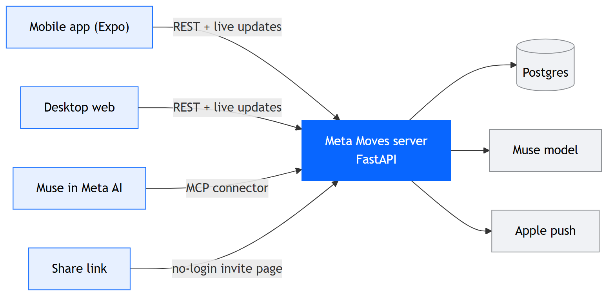

# Meta Moves

[](frontend/mobile/package.json)
[](frontend/mobile/package.json)
[](frontend/mobile/)
[](backend/pyproject.toml)

**Meta Moves turns “I'm already going” into “come join me”: share what you're doing on Facebook, and friends can Pull up with one tap.**

Built for the Meta Career Programs AI Hackathon 2026. **Meta Moves** is our
spontaneous activity-sharing feature inside a mocked Facebook experience.

## Why young adults want this

Location sharing has become a normal part of how young people keep up with each
other. Friends leave it on for each other and check the map to see who's at the
library, who's out, and who's nearby. The appeal isn't the GPS dot. Two things
drive it:

- **People like sharing what they're doing.** Posting "at the gym" or "studying
  at the café" is a small, casual way to stay present in friends' lives.
- **People like knowing what their friends are doing.** Opening the map to see
  where everyone is feels social, even when nobody says anything.

What location sharing never does is let you act on that. You can see a friend at
the coffee shop, but joining still means texting, asking, and waiting for an
answer. Most people don't bother, and the moment passes.

Moves keeps the part people love and adds the missing step. You share **what**
you're doing and **where** (a place you pick, not your live position) with the
friends you choose, and they can join with one tap. Seeing what friends are up to
turns into actually spending time together. Muse, the AI, makes sure the right
friends hear about it.

This gives young adults a reason to use Facebook alongside Instagram, growing
Facebook's younger audience through real time together. Mobile is the primary
experience; web is a companion for when a laptop is already open.

## A user story

> As a young adult already heading somewhere, I want to share what I'm doing with
> friends I choose, so they can join me without either of us having to organize a plan.

Maya is heading to a café to study. She posts “studying at Kumo, Pull up” to her
Campus friends Circle. The composer shows who can see it. Muse suggests a few
people to poke, and Maya confirms whom to notify. Priya taps **Pull up** and
appears as on the way. Once she arrives, the Move shows them together at the café.
Other people in the permitted audience can join too. Their gathering grows within
the Move; joining does not automatically create a Circle or widen its audience.

## How it works

1. Choose a **Mark**, the place pin where your activity happens. Search works
   without location permission.
2. Share a **Move**: what you're doing, plus the Circles or people who can see it.
3. Review Muse's suggested recipients and send a poke. Visibility and receiving
   a notification are separate choices.
4. Friends tap **Pull up**. The Move distinguishes people on the way from people
   who have arrived.
5. Everyone adds photos to the **Move Recap** while they're there. Afterward,
   **Ghosts** on the map show friends where the fun was, and **Memories** keep
   your own record of every outing.

## Privacy by design

- Location is opt-in. Choose a place manually when permissions are denied.
- Marks carry place coordinates. Users' live coordinates are not exposed.
- Posts have explicit audiences, shown before posting; blocks restrict access.
- A growing gathering does not make a Move public.
- Proximity-based joining requires a tap unless a person is explicitly on the
  user's auto-join list.
- Muse proposes; the user approves posting a Move or sending a Flare.
- Tagged people approve a Moment before it becomes visible beyond participants.

Every rule is enforced in the backend and covered by automated tests, so privacy
holds no matter which client is talking to the server.

## Architecture at a glance



- **One hosted server** runs everything: the REST API (`/api/v1`), live updates over a
  WebSocket, the MCP connector for Muse in Meta AI, no-login invite pages, and the desktop
  web app at `/`. Every push to `main` deploys automatically.
- **Muse powers every decision**: who to poke, how Moves are ranked, Flares for free time,
  taste from ratings, and reviving crews that are drifting apart. Each agent also has an
  instant scored path, so Muse always answers fast.
- **Muse in Meta AI** can draft and post Moves by voice through our MCP connector, from
  any device Meta AI runs on.
- **Privacy is built into the server**: one visibility check (`can_see`) guards every Move,
  no response ever carries a user's coordinates, and "near me" queries are coarse and never
  stored.

Diagram source: [docs/diagrams/architecture.mmd](docs/diagrams/architecture.mmd). Full details,
more diagrams and the product rules: [ARCHITECTURE.md](ARCHITECTURE.md).

## Stack

| Layer | Implementation |
| --- | --- |
| Mobile | Expo SDK 57, React Native 0.86, React 19, TypeScript, expo-router, zustand, react-native-maps, a native Swift Bluetooth module |
| Web | Vite, React 19, Leaflet |
| Server | FastAPI, Python 3.12, uv, SQLModel, Pydantic |
| Database | PostgreSQL |
| Realtime | WebSocket at `/api/v1/ws` plus Apple push notifications |
| AI | Muse, behind a `MuseClient` port with a scored fast path for every agent |
| Hosting | One Docker image (web + API) with Postgres via Compose, deployed on every push to `main` |

## Repository layout

```text
backend/app/        Server: domain rules, services, repositories, routes, Muse, seed data
backend/tests/      Tests by lane (core, muse, surfaces, ...) plus contract and integration
frontend/mobile/    Expo app (the main experience)
frontend/web/       Desktop web app
deploy/homelab/     Server deploy script
docs/               Task plan, Muse search, diagrams, build reviews
postman/            API smoke collections
```

## Using the app

The server is hosted and always on, so the apps just connect to it:

- **Mobile:** set `EXPO_PUBLIC_BACKEND_URL` in `frontend/mobile/.env` to the server's URL,
  then `cd frontend/mobile && npm ci && npx expo start`.
- **Desktop web:** open the server's URL in a browser. The web app is served at `/`.

Sign in as anyone in the demo world: username is their first name (for example `anish`),
password `moves`.

### Mobile builds

- **Expo Go** runs the whole app, with Bluetooth proximity driven from Demo Control
  (`EXPO_PUBLIC_PROXIMITY=sim`).
- **iOS dev build** adds real Bluetooth proximity through the native `moves-ble` module:
  `npx expo run:ios`, or `scripts/install-ios.sh` to build and install on connected phones,
  with `EXPO_PUBLIC_PROXIMITY=ble`.
- `EXPO_PUBLIC_DEMO=1` lets screens fall back to bundled sample data.

## Deployment

Every push to `main` redeploys the server through
[.github/workflows/deploy-homelab.yml](.github/workflows/deploy-homelab.yml): it pulls `main`,
rebuilds the combined web + API image, and waits for the health check. Postgres runs alongside
it. See [deploy/homelab/README.md](deploy/homelab/README.md).

```sh
docker compose up -d --build                         # web + API + Postgres
docker compose exec backend python -m app.seed.seed  # WARNING: wipes and reseeds
```

Server settings live in `backend/.env` (see [backend/.env.example](backend/.env.example)):

| Setting | What it does |
| --- | --- |
| `DATABASE_URL` | Postgres connection string. |
| `MUSE_BASE_URL`, `MUSE_API_KEY` | The Muse model API. |
| `MUSE_MODEL`, `MUSE_FAST_MODEL` | `muse-spark-1.3` for reasoning, `muse-ember-1.0` for short drafts, place extraction and crew labels. |
| `MUSE_DETERMINISTIC` | `true` (default): every agent uses its instant scored path. `false`: agents ask the model, with the scored path as backup. |
| `MUSE_VISION_MODEL` | Model for image input (Reel frames). |
| `MUSE_TOKEN_BUDGET` | Token cap per server process (default 400k). |
| `DEMO_MODE` | `on`: Demo Control and a shiftable clock. `offline`: same, with the built-in Muse client. |
| `AUTH_REQUIRE_SESSION` | `true`: every request must carry a login session token. |
| `PUBLIC_BASE_URL` | Public origin for share links (`/m/{token}`). |
| `APNS_*` | Apple push credentials. |

## Demo Control

Demo Control is hidden in every build: open **Settings** and tap the version line ("Moves
1.0.0") five times quickly, or long-press it. It needs `DEMO_MODE=on` on the server. It puts
every timed or multi-person moment one tap away:

- **Scenes**: whole beats in one tap (friends fill my Move, a friend is nearby, after the Move).
- **Time**: +10, +30, +60 minutes, back to real time, soft world reset.
- **Muse**: Flare scan, free time, revive scan, nobody bit, route ("go together?").
- **People**: friends post, pull up, arrive, leave, post a Moment tagging you, send or accept
  friend requests, and meet you over simulated Bluetooth.
- **System**: Muse live vs heuristic, a test notification for push, and every background job
  (auto-end, expiry, example Moves) on demand.

Every trigger runs the real code path, so the notifications, pushes and banners are the real
ones. Reset restores the world without dropping data. Full list in
[ARCHITECTURE.md](ARCHITECTURE.md) section 15.2.

## Muse in Meta AI (MCP connector)

The server is a remote [MCP](https://modelcontextprotocol.io) server at `POST /mcp`, so Muse
in Meta AI can start a Move by voice: "Hey Meta, send Dhivyesh a move, getting boba."

- **Tools**: `draft_move` (reads back the place and who gets poked), `confirm_move` (posts
  after the user says yes), `share_move`, `pull_up`, `friends_nearby`, `get_my_active_move`.
  Writes are idempotent on `request_id`, and every call acts as the token's owner.
- **Tokens**: one per user, minted with username and password and shown once; only a hash is
  stored. In the app, **Settings, then Connect Muse** hands Meta AI the URL and token.

```sh
# Mint a token
curl -s https://<server>/api/v1/mcp/tokens -H "Content-Type: application/json" \
  -d '{"username":"anish","password":"moves","label":"Meta AI"}'

# List the tools
curl -s https://<server>/mcp -H "Authorization: Bearer $TOKEN" \
  -H "Content-Type: application/json" -H "Accept: application/json, text/event-stream" \
  -d '{"jsonrpc":"2.0","id":1,"method":"tools/list"}'
```

Register in Meta AI with URL `https://<server>/mcp` and header `Authorization: Bearer <token>`.
`GET /api/v1/mcp/tokens` lists your tokens and `DELETE /api/v1/mcp/tokens/{id}` revokes one.

## Development

Run the stack on your own machine to build features (three terminals; a phone must be on the
same Wi-Fi):

```sh
# Server: http://localhost:8000/docs
cd backend && uv sync
uv run python -m app.seed.seed        # WARNING: wipes and rebuilds the database
uv run uvicorn app.main:app --reload --host 0.0.0.0

# Mobile: finds the server on port 8000 of this machine
cd frontend/mobile && npm ci && npx expo start

# Desktop web: http://localhost:5173, proxies /api and /media to the server
cd frontend/web && npm ci && npm run dev
```

Without `DATABASE_URL` the server uses a SQLite file, so no database setup is needed.
`uv run python -m app.seed.topup` adds missing demo data without wiping anything, and
`uv run python -m app.muse.smoke` checks the Muse connection by calling every agent once.

### Checks

```sh
cd backend && uv run pytest && uv run ruff check . && uv run ruff format --check .
cd frontend/mobile && npm run typecheck
cd frontend/web && npm run lint && npm run build
```

Backend tests run on an in-memory database, never the server's.

## Docs

| Doc | What it is |
| --- | --- |
| [ARCHITECTURE.md](ARCHITECTURE.md) | Source of truth: product rules, diagrams, data model, Muse, API, demo |
| [AGENTS.md](AGENTS.md) | Rules for contributors and coding agents |
| [backend/ARCHITECTURE.md](backend/ARCHITECTURE.md) | How a server feature is layered, and how to add one |
| [docs/BACKEND_TASKS.md](docs/BACKEND_TASKS.md) | Server lanes and issue breakdown |
| [docs/MUSE_SEARCH.md](docs/MUSE_SEARCH.md) | The map's Muse prompt box |
| [frontend/web/README.md](frontend/web/README.md) | Desktop web app and same-host deploy |
| [deploy/homelab/README.md](deploy/homelab/README.md) | Auto-deploy and the server database |
| [PROMPTS.md](PROMPTS.md) | Implementation prompts for the surfaces lane |
| `docs/*AUDIT*.md`, `docs/CORE_*.md` | Build reviews from earlier milestones |
