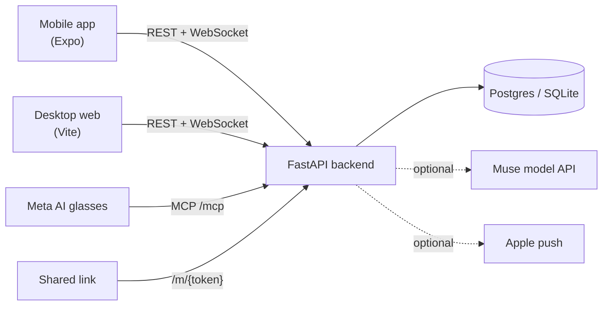

# Meta Moves

[](frontend/mobile/package.json)
[](frontend/mobile/package.json)
[](frontend/mobile/)
[](backend/pyproject.toml)

**Meta Moves turns “I'm already going” into “come join me”: share what you're doing on Facebook, and friends can Pull up with one tap.**

Built for the Meta Career Programs AI Hackathon 2026. **Meta Moves** is our
spontaneous activity-sharing feature inside a mocked Facebook experience.

## Why young adults want this

Location sharing has become a normal part of how young people keep up with each
other. Friends leave it on for each other and check the map to see who's at the
library, who's out, and who's nearby. The appeal isn't the GPS dot. Two things
drive it:

- **People like sharing what they're doing.** Posting "at the gym" or "studying
  at the café" is a small, casual way to stay present in friends' lives.
- **People like knowing what their friends are doing.** Opening the map to see
  where everyone is feels social, even when nobody says anything.

What location sharing never does is let you act on that. You can see a friend at
the coffee shop, but joining still means texting, asking, and waiting for an
answer. Most people don't bother, and the moment passes.

Moves keeps the part people love and adds the missing step. You share **what**
you're doing and **where** (a place you pick, not your live position) with the
friends you choose, and they can join with one tap. Seeing what friends are up to
turns into actually spending time together. Muse, the AI, makes sure the right
friends hear about it.

This gives young adults a reason to use Facebook alongside Instagram, growing
Facebook's younger audience through real time together. Mobile is the primary
experience; web is a companion for when a laptop is already open.

## A user story

> As a young adult already heading somewhere, I want to share what I'm doing with
> friends I choose, so they can join me without either of us having to organize a plan.

Maya is heading to a café to study. She posts “studying at Kumo, Pull up” to her
Campus friends Circle. The composer shows who can see it. Muse suggests a few
people to poke, and Maya confirms whom to notify. Priya taps **Pull up** and
appears as on the way. Once she arrives, the Move shows them together at the café.
Other people in the permitted audience can join too. Their gathering grows within
the Move; joining does not automatically create a Circle or widen its audience.

## How it works

1. Choose a **Mark**, the place pin where your activity happens. Search works
   without location permission.
2. Share a **Move**: what you're doing, plus the Circles or people who can see it.
3. Review Muse's suggested recipients and send a poke. Visibility and receiving
   a notification are separate choices.
4. Friends tap **Pull up**. The Move distinguishes people on the way from people
   who have arrived.
5. **Moments** and **Ghosts** can preserve the shared experience after it ends,
   subject to audience and approval rules.

## Privacy by design

- Location is opt-in. Choose a place manually when permissions are denied.
- Marks carry place coordinates. Users' live coordinates are not exposed.
- Posts have explicit audiences, shown before posting; blocks restrict access.
- A growing gathering does not make a Move public.
- Proximity-based joining requires a tap unless a person is explicitly on the
  user's auto-join list.
- Muse proposes; the user approves posting a Move or sending a Flare.
- Tagged people approve a Moment before it becomes visible beyond participants.

These are product requirements. The backend includes privacy tests, but this
prototype is not a production Facebook integration. Logging in returns a session
token, but by default the backend still accepts a bare `X-User-Id` header (demo
authentication); set `AUTH_REQUIRE_SESSION=true` to require the token.

## Architecture at a glance



- **One backend process** serves the REST API (`/api/v1`), a server-push WebSocket, the MCP
  server for glasses, public invite pages, and the built desktop web client at `/`.
- **Muse** makes every AI decision (who to poke, ranking, Flares, taste, revive). It runs on
  deterministic scores by default and only calls the model when `MUSE_DETERMINISTIC=false`.
  Every agent has a fallback, so the app works with the model down.
- **Privacy is enforced in code**: one visibility check (`can_see`), no user coordinates in any
  response, and coarse "near" queries that are never stored.

Full details, diagrams and the product rules: [ARCHITECTURE.md](ARCHITECTURE.md).

## Stack

| Layer | Implementation |
| --- | --- |
| Mobile | Expo SDK 57, React Native 0.86, React 19, TypeScript, expo-router, zustand, react-native-maps; a local Swift module for BLE |
| Web | Vite, React 19 (JavaScript), Leaflet |
| API | FastAPI, Python 3.12, uv, SQLModel, Pydantic |
| Database | PostgreSQL when `DATABASE_URL` is set, SQLite file otherwise |
| Realtime | WebSocket at `/api/v1/ws`, server push only; optional APNs push |
| AI | Muse behind a `MuseClient` port, deterministic scores by default |
| Deploy | One Docker image (web + API) with Postgres via Compose; `main` auto-deploys |

## Repository layout

```text
backend/app/        FastAPI app: domain rules, services, repositories, routes, Muse, seed
backend/tests/      Tests by lane (core, muse, surfaces, ...) plus contract and integration
frontend/mobile/    Expo app (the main experience)
frontend/web/       Desktop web client
deploy/homelab/     Server-side deploy script
docs/               Backend task plan, Muse search, point-in-time audits
postman/            API smoke collections
```

## Quick start

Three terminals. A phone must be on the same Wi-Fi as the backend.

```sh
# 1. Backend: http://localhost:8000/docs
cd backend
uv sync
uv run python -m app.seed.seed        # WARNING: wipes and rebuilds the database
uv run uvicorn app.main:app --reload --host 0.0.0.0

# 2. Mobile
cd frontend/mobile
npm ci
npx expo start

# 3. Desktop web (optional): http://localhost:5173
cd frontend/web
npm ci
npm run dev
```

Sign in as any seeded person: username is their first name (for example `anish`), password
`moves`.

## Running locally

### Backend

- Startup creates missing tables but adds no data. Fill it with
  `uv run python -m app.seed.seed` (drops everything first, including a Postgres database
  chosen by `DATABASE_URL`) or `uv run python -m app.seed.topup` (adds only missing seed rows,
  safe on a shared database).
- Settings go in `backend/.env`; see [backend/.env.example](backend/.env.example).

| Setting | What it does |
| --- | --- |
| `DATABASE_URL` | Postgres connection string. Unset: SQLite at `DB_PATH` (default `backend/data/app.db`). |
| `DEMO_MODE` | `on`: Demo Control routes (`/demo/*`) and a shiftable clock. `offline`: same, plus the fake Muse client. |
| `MUSE_DETERMINISTIC` | `true` (default): no model calls. `false`: agents call the model and fall back to scores. |
| `MUSE_BASE_URL`, `MUSE_API_KEY` | The Muse model API. No key means the fake client. |
| `MUSE_MODEL`, `MUSE_FAST_MODEL` | Default `muse-spark-1.3` and `muse-ember-1.0` (short drafts, place extraction, crew labels). Environment values win over defaults; restart after changing. |
| `MUSE_VISION_MODEL` | Set only once image input is confirmed. |
| `MUSE_TOKEN_BUDGET` | Tokens one process may spend before every agent falls back (default 400k). |
| `AUTH_REQUIRE_SESSION` | `true`: requests need a login session token; a bare `X-User-Id` is ignored. |
| `PUBLIC_BASE_URL` | Public origin for shared links (`/m/{token}`). |
| `FRONTEND_HOST` | Allowed browser origin (CORS). Default is Expo web, `http://localhost:8081`. |
| `APNS_*` | Apple push. All four set: notifications also go to phones. |

Check the Muse setup with `uv run python -m app.muse.smoke` (calls every agent once).

### Mobile

- The app finds the backend on port 8000 of the machine serving the Expo bundle. Set
  `EXPO_PUBLIC_BACKEND_URL` in `frontend/mobile/.env` to use a deployed backend instead.
- **Expo Go works** for everything except real Bluetooth; proximity is then simulated through
  Demo Control (`EXPO_PUBLIC_PROXIMITY=sim`).
- **Real BLE** needs an iOS dev build with the local `moves-ble` module: `npx expo run:ios`, or
  `scripts/install-ios.sh` to build and install on connected phones. Then set
  `EXPO_PUBLIC_PROXIMITY=ble`.
- `EXPO_PUBLIC_DEMO=1` shows Demo Control in the Menu and allows the bundled sample world when
  the backend is unreachable.
- Public Expo variables are bundled into the app. Never put secrets in them.

### Desktop web

A separate client from Expo web. In dev, Vite proxies `/api` and `/media` to the backend. See
[frontend/web/README.md](frontend/web/README.md).

## Demo mode

Run the backend with `DEMO_MODE=on` and the app with `EXPO_PUBLIC_DEMO=1`. Demo Control (in the
Menu) can shift time, fire a Flare scan, simulate friends being together, make friends post,
join or leave, end a Move and trigger the "nobody bit" path, so every timed or multi-person step
of the demo is one tap. Reset restores the world without dropping data. Full list in
[ARCHITECTURE.md](ARCHITECTURE.md) section 15.2.

## Deployment

```sh
docker compose up -d --build                         # web + API + Postgres
docker compose exec backend python -m app.seed.seed  # WARNING: wipes and reseeds
```

The combined image serves web at `/` and the API at `/api/v1` on one origin; point the mobile
build's `EXPO_PUBLIC_BACKEND_URL` at it. **Every push to `main` redeploys the homelab** through
[.github/workflows/deploy-homelab.yml](.github/workflows/deploy-homelab.yml); see
[deploy/homelab/README.md](deploy/homelab/README.md). Server `.env`, `backend/.env` and
`secrets/` are never committed.

## Moves MCP server (Meta AI glasses)

The backend is a remote [MCP](https://modelcontextprotocol.io) server at `POST /mcp`
(Streamable HTTP, stateless) so Meta AI can draft and post Moves by voice.

- **Tools**: `draft_move` (writes nothing), `confirm_move` (only after the user says yes),
  `share_move`, `pull_up`, `friends_nearby`, `get_my_active_move`. Writes are idempotent on
  `request_id`; every call acts as the token's owner.
- **Tokens**: one per user, minted with username and password, shown once, only its hash
  stored. Minting again replaces it. Any other token, or none, gets 401.

```sh
# Mint a token
curl -s http://localhost:8000/api/v1/mcp/tokens -H "Content-Type: application/json" \
  -d '{"username":"anish","password":"moves","label":"Ray-Bans"}'

# Expose the backend publicly (or use the deployed host)
cloudflared tunnel --url http://localhost:8000

# Try it
curl -s http://localhost:8000/mcp -H "Authorization: Bearer $TOKEN" \
  -H "Content-Type: application/json" -H "Accept: application/json, text/event-stream" \
  -d '{"jsonrpc":"2.0","id":1,"method":"tools/list"}'
```

Register in Meta AI with URL `https://<host>/mcp` and header `Authorization: Bearer <token>`.
`GET /api/v1/mcp/tokens` lists your tokens and `DELETE /api/v1/mcp/tokens/{id}` revokes one.
In the app, Settings then Connect Muse does the same hand-off. For interactive testing:
`npx @modelcontextprotocol/inspector`.

## Checks

```sh
cd backend && uv run pytest && uv run ruff check . && uv run ruff format --check .
cd frontend/mobile && npm run typecheck
cd frontend/web && npm run lint && npm run build
```

Backend tests run on in-memory SQLite and never touch `DATABASE_URL`.

## Docs

| Doc | What it is |
| --- | --- |
| [ARCHITECTURE.md](ARCHITECTURE.md) | Source of truth: product rules, diagrams, data model, Muse, API, demo |
| [AGENTS.md](AGENTS.md) | Rules for contributors and coding agents |
| [backend/ARCHITECTURE.md](backend/ARCHITECTURE.md) | How a backend feature is layered, and how to add one |
| [docs/BACKEND_TASKS.md](docs/BACKEND_TASKS.md) | Backend lanes and issue breakdown |
| [docs/MUSE_SEARCH.md](docs/MUSE_SEARCH.md) | The map's Muse prompt box |
| [frontend/web/README.md](frontend/web/README.md) | Desktop web client and same-host deploy |
| [deploy/homelab/README.md](deploy/homelab/README.md) | Auto-deploy and the server database |
| [PROMPTS.md](PROMPTS.md) | Implementation prompts for the surfaces lane |
| `docs/*AUDIT*.md`, `docs/CORE_*.md` | Point-in-time reviews; may be out of date |
